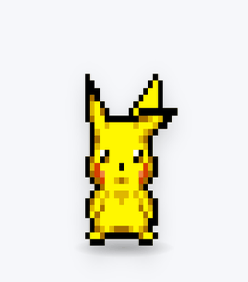
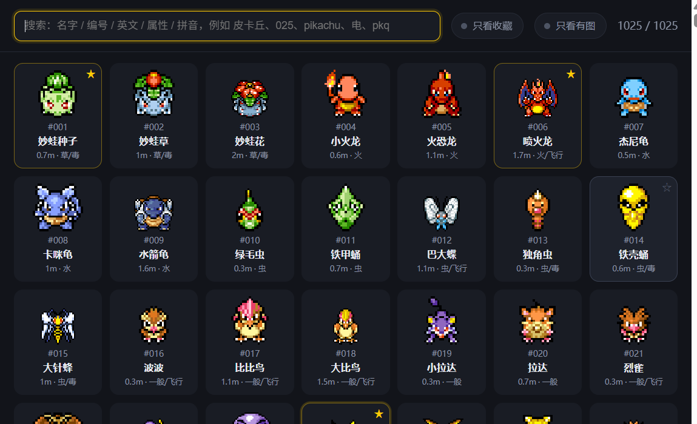

# 宝可梦桌宠 (PokePet)


把 **1025 只宝可梦**放进 Windows 桌面 —— 一只像素小人站在任务栏上方，会走动、会打瞌睡、被摸头会点头、被拎起来会挣扎、饿了能喂树果。

| | |
|---|---|
| 图鉴 | 1025 只 |
| 有逐帧动作 | 987 只 |
| 动作总数 | 17,609 个 |
| 叫声 | 1025 个 |
| 体积 | 约 400 MB（解压后，含 Electron 运行时） |
| 系统 | Windows 10 / 11 x64 |



> 非官方粉丝作品，与 Nintendo / Game Freak / The Pokémon Company 无关。
> 完全免费，不售卖、不含任何付费内容。

---

## 下载

**[⬇ 下载最新版](https://github.com/xzy1220/pokepet/releases/latest)** → 解压 → 双击 `PokePet.exe`

第一次运行 Windows 可能弹 SmartScreen「未知发布者」，因为没买代码签名证书。点「更多信息 → 仍要运行」即可。

**不想手动解压？** 把这段话发给任意能执行命令的 AI：

```
帮我把宝可梦桌宠装到这台电脑上：
1. 下载 https://github.com/xzy1220/pokepet/releases/latest/download/PokePet-v0.1.0-win64.zip
2. 解压到 %LOCALAPPDATA%\PokePet
3. 在桌面创建快捷方式「宝可梦桌宠」，指向 PokePet.exe
4. 启动它
exe 没有代码签名，如果弹 SmartScreen 就选「更多信息 → 仍要运行」。
```

---

## 功能



**选宠器**：1025 只全在里面，支持中文名 / 编号 / 英文名 / 属性 / **拼音**搜索（`pkq` → 皮卡丘，`mwzz` → 妙蛙种子），可以星标收藏、只看收藏、只看有图。

**动作**：每只有 1~38 个动作（待机、走路、坐下、睡觉、醒来、点头、蹦、被碰到、剧痛、吃东西、放电、转圈……），按场景自动切换 —— 空闲 20~110 秒后它开始自己安排时间：睡觉，或者在屏幕上溜达几段。

**喂食**：右键 → 吃东西 → 六种树果，果子会停在嘴边、缩小消失、头顶冒爱心、叫一声。

**跟随**：右键 → 走过来，它会一直跟着鼠标走，碰到就停下；再点一次「停止走过来」结束。

| 操作 | 效果 |
|---|---|
| 左键点一下 | 点头打招呼 |
| 按住拖动 | 拎起来（会挣扎），松手放下 |
| 右键 | 选宝可梦 / 喂食 / 动作 / 跟随 / 归位 |
| 托盘图标左键 | 打开选宠器 |
| 托盘菜单 | 开机自启 / 支持一下 / 关于 / 退出 |

---

## 已知问题

这些是明确的限制，不是玄学 bug：

- **38 只没有动作素材**（如索财灵、密勒顿、铁头壳）。SpriteCollab 社区没做过，界面上显示占位卡。
- **走路是移动窗口**，不是脚贴地走，所以在屏幕中间松手它就停在那儿，不会掉下去。
- **命中区按待机帧计算**，走路时角色比待机宽，边缘可能点不到。
- **只有 Windows**，没做 macOS / Linux。
- **没有代码签名**，首启会被 SmartScreen 拦一次。

---

## 从源码构建

仓库里**不含** `app/pmd`（20,543 张动作帧）和 `app/cries`（1025 个叫声），体积太大。它们可以完全重建：

```powershell
# 1. 下载 PMD 原始素材（约 5,800 个文件，1 分钟）
python tools\prewarm.py

# 2. 切成每只宝可梦的动作条（约 8 分钟）
python tools\pmd-batch.py --all-actions --workers 8

# 3. 下载叫声（约 90 秒）
node tools\fetch-cries.mjs --max-id 1025 --concurrency 8

# 4. 生成选宠器卡片缩略图
python tools\build-cards.py

# 5. 生成拼音索引（pip install pypinyin，仅构建期）
python tools\build-pinyin.py
```

跑完素材齐全，然后：

```powershell
# 开发态直接跑（需要任意 electron 43.x 运行时）
.\启动宠物.cmd

# 打包成可分发的 zip
powershell -ExecutionPolicy Bypass -File tools\package-release.ps1
```

---

## 目录结构

```
app\            主程序（main.js / pet.js / picker.js / 关于与支持窗口）
  pmd\          动作帧（构建产物，20,543 张 PNG + 987 个 JSON 索引）
  cries\        叫声（1025 个，Ogg/MP3 混合）
assets\         选宠器卡片、树果图、图鉴索引、拼音索引、赞赏码
data\           运行时数据（config.json 记位置/收藏/行为参数；不入库）
docs\images\    README 配图
tools\          构建与打包脚本
```

---

## 素材来源

- **动作帧**：[PMD SpriteCollab](https://github.com/PMDCollab/SpriteCollab)（社区重绘的《不可思议迷宫》风格素材），**CC BY-NC 4.0** —— 禁止商用。
- **叫声 / 图鉴数据**：[PokeAPI](https://github.com/PokeAPI/pokeapi)（CC BY 4.0）。
- **树果图标**：PokeAPI/sprites。

素材版权归各位画师与原作者。这里只是把社区素材免费用起来，不售卖、不含任何付费内容。
如果哪位作者不希望自己的作品出现在这里，联系我立刻下架。

## 许可

**代码**（`app/`、`tools/` 里的脚本）采用 [MIT](LICENSE)。
**素材**（`app/pmd`、`app/cries`、`assets/`）遵循各自的 CC 协议，**其中 PMD SpriteCollab 是 CC BY-NC 4.0，不可商用**。
